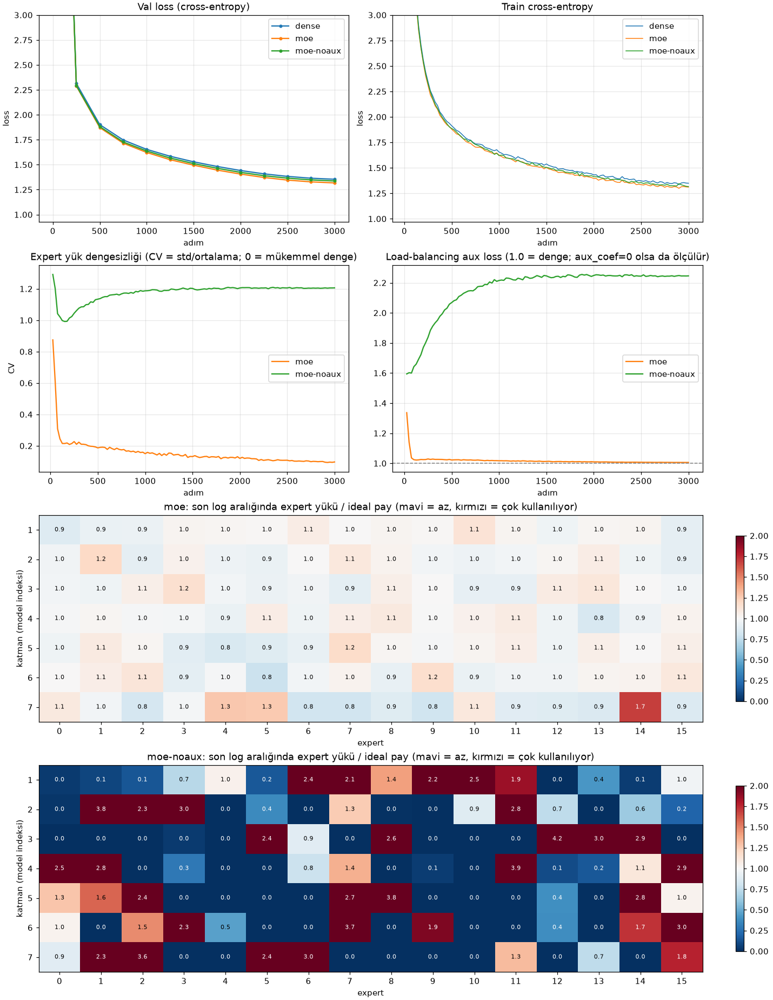
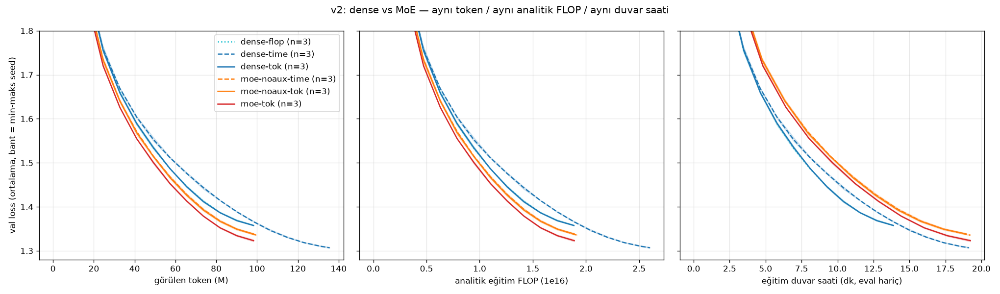
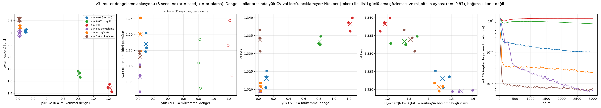

# moe-llm

Sıfırdan, PyTorch ile yazılmış küçük bir **Mixture-of-Experts (MoE)** dil modeli.
Amaç: öğrenmek ve tek bir tüketici GPU'sunda (RTX 4070 Super, 12 GB VRAM) eğitilebilecek
ölçekte, Kimi K2 / DeepSeek-V3 tarzı MoE fikirlerini denemek.

## Yol haritası

1. ✅ **Dense baseline** — decoder-only Transformer (nanoGPT iskeleti + RoPE, RMSNorm, SwiGLU),
   kendi BPE tokenizer'ımız, eğitim döngüsü, checkpoint/resume, örnek üretim
2. ✅ **MoE** — FFN yerine router (top-k) + N expert + shared expert + load-balancing (auxiliary)
   loss + z-loss, expert kullanım logları, aux loss ablasyonu ve uzmanlaşma analizi
3. ✅ **Gruplu dispatch + adil karşılaştırma** — expert'ler döngü yerine gruplu matris çarpımıyla
   (`torch._grouped_mm`), analitik FLOP muhasebesi, token tabanlı LR/bütçe ve dense ile MoE'nin
   aynı token / aynı FLOP / aynı duvar saati / aynı aktif parametrede 3 seed'le karşılaştırılması
4. ✅ **Router dengeleme ablasyonu** — router davranışı bir regularizer artefaktı mı? Altı dengeleme
   koşulu (aux katsayısı 0 / 0.001 / 0.01 / 0.1 / 1.0 ve aux-loss'suz seçim bias'ı) × 3 seed, denge ile
   uzmanlaşmayı ayıran ölçütler, "sahte denge" ve "sözlükleşme" testleri
5. ⏳ **FOTON v0.1** — sequence düzeyinde top-1 routing ile üç modül. Deney ön-kaydı **koddan önce**
   sabitlendi ve `foton-v01-prereg` tag'iyle donduruldu: [`PREREGISTRATION.md`](PREREGISTRATION.md).
   Birincil ölçüt önceden belirlenmiş val loss hedefine (L\* = 1.3592) ulaşmak için gereken aktif FLOP;
   karar tablosu, seed politikası, test aileleri ve güç kalibrasyonu orada

## Klasör yapısı

```
src/
  config.py      tüm hiperparametreler + preset'ler (tiny, dense, moe, moe-noaux, tiny-moe)
  tokenizer.py   SentencePiece BPE (varsayılan) / tiktoken GPT-2
  model.py       Transformer: RMSNorm, RoPE, attention, SwiGLU; Block'ta dense FFN veya MoE
  moe.py         MoE: router (top-k), expert dispatch/combine (gruplu ya da döngü), shared expert, aux/z-loss, denge metrikleri
  data.py        memmap üzerinden rastgele pencere örnekleyen veri yükleyici
  train.py       eğitim döngüsü (bf16, grad accumulation, token tabanlı cosine LR, eval, checkpoint, expert logları)
  flops.py       analitik aktif FLOP hesabı (türetim: docs/flops.md)
  stats.py       karar istatistiği: seed eşleştirmeli fark, Holm/BH, ön-kayıt karar tablosu (kod olarak)
  checkpoint.py  atomik kaydetme, checkpoint'ten model yükleme
  sample.py      metin üretimi
scripts/
  download_tinystories.py   veri setini indir (kaldığı yerden devam eder)
  prepare_data.py           tokenizer eğit + train.bin / val.bin üret
  benchmark.py              batch boyutuna göre VRAM ve throughput ölçümü
  plot_metrics.py           koşuları karşılaştıran grafikler (loss, yük dengesi, ısı haritası)
  analyze_experts.py        eğitilmiş MoE'de expert yükü ve hangi tokenlarda uzmanlaştıkları
  backup_bundle.py          git deposunun tamamını doğrulanmış tek bir bundle dosyasına yedekle
  flops_report.py           analitik FLOP tablosu + profiler çapraz kontrolü
  verify_dispatch.py        GPU'da "grouped" ve "loop" expert yollarının eşdeğerliği
  run_queue.py              koşu kuyruğu (sırayla, kaldığı yerden, kod izi kaydıyla)
  compare_curves.py         100 adımlık eşdeğerlik koşularının loss eğrileri
  compare_runs.py           hız benchmark'ı + dört karşılaştırma (aynı token / FLOP / süre / aktif parametre)
  router_analysis.py        bir checkpoint'te router: denge, uzmanlaşma, karşı-olgusal CE, dengeleme kuvveti
  compare_router.py         dengeleme koşullarını karşılaştır (tablo + eşleştirilmiş farklar + grafik)
  power_analysis.py         ön-kaydın güç kalibrasyonu (yalnızca baseline gürültüsünden)
tests/           CPU'da çalışan doğruluk testleri (nedensellik, RoPE, init, overfit, MoE dispatch, LR schedule,
                 FLOP, router, ölçüt null'ları, karar istatistiği ve karar tablosu) — 196 test
docs/            README'deki grafikler + flops.md (FLOP türetimi) + router_metrics.md (router ölçütleri)
experiments/     donmuş deney kayıtları: config, metrics.jsonl, train.log, ortam, checksum'lar
PREREGISTRATION.md  FOTON v0.1 ön-kaydı: hedef, karar tablosu, test aileleri, kalibrasyon (dondurulmuş)
data/            ham metin + token dosyaları (git'e girmez)
checkpoints/     eğitim çıktıları: last.pt, best.pt, metrics.jsonl, train.log (git'e girmez)
```

## Kurulum (Windows / PowerShell)

```powershell
py -3.13 -m venv .venv
.\.venv\Scripts\python -m pip install -r requirements.txt
```

> Not: PyPI'daki `torch` Windows'ta CPU-only'dir. `requirements.txt` CUDA build'ini
> (`torch==2.14.0+cu130`) PyTorch index'inden sabitler. Kontrol:
> `.\.venv\Scripts\python -c "import torch; print(torch.cuda.is_available())"`

## Kullanım

```powershell
# 1) Veri: ~2.2 GB indir, 8k'lık BPE tokenizer eğit, ~546M token'a çevir (~3 dk)
.\.venv\Scripts\python scripts\download_tinystories.py
.\.venv\Scripts\python scripts\prepare_data.py

# 2) Testler (CPU, birkaç saniye)
.\.venv\Scripts\python -m pytest -q tests

# 3) Eğitim
.\.venv\Scripts\python -m src.train --preset tiny --run_name smoke   # saniyeler: uçtan uca kontrol
.\.venv\Scripts\python -m src.train --preset dense                   # ~30M param, ~15-20 dk
.\.venv\Scripts\python -m src.train --preset dense --resume true     # yarıda kaldıysa devam
.\.venv\Scripts\python -m src.train --preset dense --run_name lr5e4 --lr 5e-4   # her alan ezilebilir

.\.venv\Scripts\python -m src.train --preset moe                     # 79M toplam / 30M aktif MoE, ~20 dk
.\.venv\Scripts\python -m src.train --preset moe-noaux               # ablasyon: load-balancing loss kapalı
.\.venv\Scripts\python -m src.train --preset moe --moe_impl loop      # v1'in expert döngüsü (aynı matematik)

#    Bütçe ve LR schedule GÖRÜLEN TOKEN üzerinden tanımlı (bkz. src/train.lr_at): eşit süre/FLOP karşılaştırmasında
#    bütçe token olarak verilir, warmup her modelde aynı tokenda biter.
.\.venv\Scripts\python -m src.train --preset dense --max_tokens 98467840   # = 3005 adım
.\.venv\Scripts\python -m src.train --preset moe --stop_step 100           # schedule aynı, 100. adımda dur

# 4) Metin üretimi
.\.venv\Scripts\python -m src.sample --ckpt checkpoints\dense\best.pt --prompt "Once upon a time"

# 5) Analiz
.\.venv\Scripts\python scripts\plot_metrics.py --runs dense moe moe-noaux --out docs\dense_vs_moe.png
.\.venv\Scripts\python scripts\analyze_experts.py --ckpt checkpoints\moe\best.pt --layer 4
.\.venv\Scripts\python scripts\flops_report.py            # analitik FLOP tablosu + profiler çapraz kontrolü
#    Not: aşağıdaki betiklerin varsayılan çıktı yolları experiments\v2-grouped-dispatch\ içindeki DONMUŞ kayıttır;
#    yeniden koşarken --out / --plot ile başka bir yere yazın.
.\.venv\Scripts\python scripts\verify_dispatch.py --out checkpoints\verify_dispatch.json      # grouped vs loop (GPU)
.\.venv\Scripts\python scripts\verify_dispatch.py --deterministic --out checkpoints\verify_dispatch_det.json
.\.venv\Scripts\python scripts\run_queue.py experiments\v2-grouped-dispatch\queues\main_tok_flop.json
.\.venv\Scripts\python scripts\compare_runs.py --out checkpoints\summary.json --plot docs\v2_yeni.png
.\.venv\Scripts\python scripts\compare_curves.py --out checkpoints\verify_100step.json

#    Router dengeleme ablasyonu (v3): tek checkpoint analizi, sonra koşulların karşılaştırması.
#    --analyze eksik analiz dosyalarını üretir; varsayılan yollar experiments\v3-router-ablation\ DONMUŞ kaydıdır.
.\.venv\Scripts\python scripts\router_analysis.py --ckpt checkpoints\moe\best.pt --out checkpoints\router.json
.\.venv\Scripts\python scripts\compare_router.py --analyze --analysis checkpoints\router_analiz `
    --out checkpoints\v3.json --plot docs\v3_yeni.png

# 6) Yedek: her kilometre taşından (commit + tag) sonra tüm git geçmişini D:'ye al.
#    Önce doğrular (ref'ler + temiz klon + fsck), sonra değiştirir; önceki kilometre taşı .prev'de kalır.
#    Eski bir yedek, geçmişinin tamamı yenisinde yoksa (tag silinmiş, reset/rebase/amend) ya da bozuksa silinmez:
#    tarihli bir kopya olarak kenara alınır ve betik uyarır.
#    data/ ve checkpoints/ git'te olmadığı için bundle'a girmez.
.\.venv\Scripts\python scripts\backup_bundle.py
git clone "D:\foton gama v1 yedek\moe-llm.bundle" moe-llm          # geri yükleme (diğer branch'ler origin/<ad> olarak gelir)
git clone --mirror "D:\foton gama v1 yedek\moe-llm.bundle" moe-llm.git   # tüm ref'ler aynen (stash dahil)
```

MoE koşularında konsol logu her log aralığında denge özetini, her eval'de de katman başına
expert yük çubuklarını basar (`▄` = ideal pay 1/E, `█` ≈ 1.9x+ aşırı yük, boşluk = ölü expert):

```
adım  3000 | loss 1.3214 | lr 1.00e-04 | grad_norm 0.25 | 81.7k tok/s | tepe bellek 8.92 GB
           ce 1.3111 | aux 1.006 | z 0.25 | yük CV 0.097 | maks 1.70x | min 0.79x | ölü expert 0
[expert] katman 4: |▄▄▄▄▄▄▄▄▄▄▄▄▄▃▄▄| min 0.84x maks 1.09x
```

## Deney kaydı: `v1-dense-moe-baseline` (2026-09-15)

> **Donmuş kayıt.** Bu bölüm referans noktamızdır; sonraki deneyler yeni bir bölüm olarak
> eklenmeli, buradaki sayılar değiştirilmemelidir. Kod + kayıt git tag'inde saklıdır:
> `git checkout v1-dense-moe-baseline`. Ham metrikler, config'ler ve loglar
> [`experiments/v1-dense-moe-baseline/`](experiments/v1-dense-moe-baseline/) altında.

### Adım 1: Dense baseline (`--preset dense`)

29.9M parametre (8 katman, d=512, 8 head, SwiGLU 1408, V=8192), 3000 adım x 32 768 token
= **98M token** (TinyStories'in ~%18'i), RTX 4070 Super'da **15.5 dakika**, 115k tok/s, tepe VRAM 6.3 GB.

| adım | 0 | 500 | 1000 | 2000 | 3000 |
|---|---|---|---|---|---|
| val loss | 9.12 | 1.90 | 1.65 | 1.44 | **1.354** (ppl 3.87) |

Örnek (`--prompt "Once upon a time, there was a little dragon who"`, temperature 0.8, top-k 50):

> Once upon a time, there was a little dragon who lived in a big cave. This dragon was not a bad
> dragon. He was an original dragon, not like any other dragon. The dragon felt sad and wanted to
> find a new home. One day, the dragon met a little girl. The girl said, "Hello, dragon! I can help
> you find a new home." [...] From that day on, they became the best of friends.

### Adım 2: MoE (`--preset moe`) ve aux loss ablasyonu (`--preset moe-noaux`)

Mimari (Kimi K2 / DeepSeek-V3 fikirleri, ev ölçeğinde): katman 0 dense; katman 1-7'de FFN yerine
**16 ince taneli routed expert (SwiGLU 352) içinden top-3 + 1 shared expert**. Token başına aktif
FFN = 4 x 352 = 1408 = dense ile aynı, yani **aynı aktif hesap**: dense 29.89M, MoE 29.95M aktif
parametre (fark router'lar), ama MoE'nin toplamı **79.2M**. Load-balancing aux loss (0.01) +
router z-loss (0.001), dropless routing, router float32'de. Üç koşu da aynı 3000 adım x 32 768 token.

| | dense | **moe** (aux açık) | moe-noaux (aux kapalı) |
|---|---|---|---|
| toplam / aktif parametre | 29.9M / 29.9M | 79.2M / 30.0M | 79.2M / 30.0M |
| val loss @1000 / @2000 | 1.653 / 1.442 | **1.622 / 1.406** | 1.637 / 1.423 |
| **val loss @3000** | 1.354 (ppl 3.87) | **1.317 (ppl 3.73)** | 1.337 (ppl 3.81) |
| toplam süre (eval dahil) / throughput (medyan) | 15.5 dk / 115k tok/s | 23.3 dk / 79k tok/s | 22.1 dk / 81k tok/s |
| tepe VRAM (batch 32) | 6.3 GB | 8.9 GB | 8.9 GB |
| yük CV (0 = denge) | – | **0.097** | 1.206 |
| en çok / en az yüklü expert | – | 1.70x / 0.79x | 4.18x / 0.00x |
| ölü expert (< ideal payın %10'u) | – | **0 / 112** | **49 / 112** |
| aux loss değeri (1.0 = denge) | – | 1.006 | 2.246 |



Çıkarımlar:
- **Aynı aktif hesapla MoE daha iyi**: val loss 1.354 → 1.317. Ekstra kapasite (4.25x FFN
  parametresi) token başına hesap artmadan kaliteye dönüşüyor — MoE'nin temel vaadi.
- **Aux loss olmadan expert collapse gerçekten oluyor ve çok erken**: 100. adımda 30, sonunda 49
  expert (%44) ölü; aşırı yüklü expert'ler ideal payın 4 katını alıyor. Bedeli: val loss
  1.317 → 1.337; MoE'nin dense'e karşı kazancının (0.037) yarısından fazlası kayboluyor.
  Çöküş ilk birkaç yüz adımda kilitleniyor ve sonra geri dönmüyor (eğitim log aralığı başına,
  7 MoE katmanı x 16 = 112 expert üzerinden):

  | adım | 100 | 500 | 1000 | 2000 | 3000 |
  |---|---|---|---|---|---|
  | moe — ölü expert / yük CV | 0 / 0.244 | 0 / 0.187 | 0 / 0.150 | 0 / 0.120 | 0 / 0.097 |
  | moe-noaux — ölü expert / yük CV | 30 / 1.021 | 45 / 1.134 | 48 / 1.187 | 50 / 1.205 | 49 / 1.206 |
  | moe-noaux — aux loss değeri | 1.642 | 2.068 | 2.215 | 2.248 | 2.246 |

  Aux loss'lu modelde dengesizlik eğitim boyunca azalmaya devam ediyor; aux'suz modelde ise
  aux değeri (katsayı 0 olsa da ölçülüyor) ~2.25'e tırmanıp orada kalıyor (1.0 = denge,
  E/k = 5.33 = tam çöküş).
- **Uzmanlaşma** (`analyze_experts.py`, katman 4, lift = P(expert|token)/P(expert)):
  aux'lu modelde expert 5 özne/isimler (`▁She ▁He ▁Tim ▁girl ▁Lily`), expert 7 noktalama ve cümle
  sonları (`. ." ! ?" <0x0A>`), expert 13 hikâye açılışları (`▁Once ▁upon </s>`) — lift'ler 4-6.
  Aux'suz modelde aynı katmanda 5 expert hiç çalışmıyor; 2.5-3.9x yüklü "genelci" expert'lerin
  lift'i yalnızca ~1.3-2 (belirgin bir uzmanlık yok).
  *(v3 notu: bu sonuç bilgi-teorik ölçütlerle de doğrulandı — aux'suz modelde I(token;expert) 2.43 → 1.49 bit
  ve null üstü routing tutarlılığı 0.495 → 0.371. Ama lift tablosu tek başına yeterli bir uzmanlaşma kanıtı
  değil: dengeli kolların hepsinde okunabilir kümeler var, aux'u 100× güçlendirenler dahil. Bkz. Adım 4.5.)*
- **Dikkat — duvar saati** *(v2 notu: bu maddedeki neden açıklaması ölçümle doğrulanmadı; expert döngüsünün payı
  ölçülebilir düzeyde değil ve eşit sürede dense'in gördüğü fazla token ~%50 değil ölçülen %38. Bkz. Adım 3.2 ve 3.7;
  aşağıdaki sayılar v1 kaydı olarak olduğu gibi bırakıldı.)*: MoE 1.46x daha yavaş (79k vs 115k tok/s). Bu naif tek-GPU
  uygulamasında (expert başına Python döngüsü, sıralama/gather/scatter) FLOPs eşitliği hıza
  yansımıyor; aynı *süre* verilse dense ~%50 daha fazla token görebilirdi. Adil bir "aynı süre"
  karşılaştırması ve grouped GEMM / `torch.compile` ile hızlandırma sonraki deneyler.

Örnek (MoE, aynı prompt ve seed):

> Once upon a time, there was a little dragon who loved to bake. Every day, he would go out and
> bake delicious cookies. One day, the dragon was walking around when he came across a big room
> with a big, round cake on the front. The dragon was so excited. "Wow!" he said. Suddenly, a
> voice called out from behind him. It was his friend, the butterfly. "What are you doing?"
> "I'm baking a strawberry pie," said the dragon. [...]

### Ortam ve tekrar üretim

- **Donanım/yazılım**: RTX 4070 SUPER 12 GB (sürücü 616.64), Windows 11, Python 3.13.14,
  torch 2.14.0+cu130. Tam `pip freeze`: `experiments/v1-dense-moe-baseline/environment.txt`
- **Veri**: TinyStoriesV2-GPT4, SentencePiece BPE V=8192 (`data/sp8k`), train 545 813 247 token,
  val 5 512 219 token. Her koşu yalnızca 98M token gördü (tek epoch'un ~%18'i).
- **Ortak eğitim ayarları**: seq 512, mikro-batch 32 x grad_accum 2, AdamW (β 0.9/0.95, wd 0.1),
  lr 1e-3 → 1e-4 cosine, 200 adım warmup, grad clip 1.0, bf16 autocast, seed 1337. Val loss:
  sabit seed'li 40 x 32 pencere. Koşu başına tam config: `experiments/.../<koşu>/config.json`
- **Her koşunun eğitildiği kod durumu** (koşular commit'ler arasında başlatıldı):

  | koşu | kod | tag'e göre fark |
  |---|---|---|
  | dense | `f0f8494` | inceleme düzeltmeleri yok: veri penceresi üst sınırı 1 token dar (farklı veri sırası) |
  | moe | `f0f8494` + commit'lenmemiş MoE kodu | yukarıdakine ek olarak MoE inceleme düzeltmeleri yok |
  | moe-noaux | `2b13e7d` + commit'lenmemiş MoE kodu | MoE inceleme düzeltmeleri yok |

  MoE inceleme düzeltmeleri bu konfigürasyonun (top-3, float32 ağırlık) matematiğini değiştirmiyor
  (router `F.linear`'a geçti, `bincount` tekrar kullanılıyor, top-1 kuralı, yorumlar). `dense` ve
  `moe` birebir aynı veri sırasını gördü; `moe-noaux`'unkiler farklı (gürültü düzeyinde fark).
- **Tekrar üretmek**: `git checkout v1-dense-moe-baseline`, ardından Kullanım bölümündeki veri
  hazırlama + `--preset dense|moe|moe-noaux` komutları. GPU çekirdekleri deterministik olmadığından
  birebir aynı sayılar değil, aynı eğilimler beklenmeli.
- **Grafiği arşivden yeniden çizmek** (checkpoint gerekmez; `docs/dense_vs_moe.png` ile bayt bayt aynı):
  `python scripts/plot_metrics.py --runs dense moe moe-noaux --ckpt_dir experiments/v1-dense-moe-baseline`
- **Model ağırlıkları git'te değil** (`checkpoints/<koşu>/best.pt`, `last.pt`; toplam ~2.9 GB).
  Yedeklerin doğrulanması için SHA-256 değerleri: `experiments/v1-dense-moe-baseline/checksums.txt`

## Deney kaydı: `v2-grouped-dispatch` (2026-09-16)

> Bu adımda modelde değişen tek şey MoE expert hesabının **nasıl** yapıldığı. Tokenizer, attention, optimizer,
> model boyutu, parametre düzeni ve başlatma aynı kaldı. Eğitim döngüsüne yalnızca ölçüm için eklemeler yapıldı:
> token tabanlı bütçe/LR, eğitim duvar saatinin ayrı kaydı, `--stop_step`, `--save_checkpoints`.
> Ham kayıtlar, doğrulama çıktıları ve kuyruklar: [`experiments/v2-grouped-dispatch/`](experiments/v2-grouped-dispatch/).

### Adım 3.1: Ne değişti

`ModelConfig.moe_impl` iki yol sunar, ikisi de aynı parametreleri, aynı sıralamayı ve aynı combine'ı kullanır:

- `"loop"`: v1'in yolu. Tokenlar expert'e göre sıralanır, her expert kendi dilimini ayrı bir modül çağrısıyla işler.
- `"grouped"` (yeni varsayılan): aynı sıralı tokenlar; 16 expert'in SwiGLU ağırlıkları `(E, h, d)` olarak istiflenip
  üç `torch._grouped_mm` çağrısında işlenir (MegaBlocks'un dMoE "grouped GEMM" yolu). Dilim sınırları GPU'da kalır
  (`offs = cumsum(counts)`), `counts.tolist()` senkronu kalkar. MegaBlocks'un block-sparse yolu Triton ister,
  Windows'ta triton yok; block-diagonal bir matrisin block-sparse çarpımı zaten gruplu GEMM'e denk.
- Satırlar önce bf16'ya çevrilip sonra kopyalanır (yarı bellek trafiği). Gate ve up kolları ayrı çıktı alır ki geri
  yönde iki kolun gradyanı `loop`'ta olduğu gibi float32'de toplansın.
- `_grouped_mm`'nin kabul etmediği boyutlarda (adımlar 16 baytın katı olmalı: bf16'da boyutlar 8'in katı)
  otomatik olarak `loop` yoluna düşülür ve bir kez uyarılır. Presetler bu şartı sağlar.

### Adım 3.2: MoE neden yavaş — ölçüm, tahmin değil

v1'de MoE dense'e göre 1.46x yavaştı ve bunu "expert başına Python döngüsü"ne bağlamıştık. **Ölçüm bunu
doğrulamadı.** RTX 4070 SUPER (SM89) + torch 2.14'te `torch._grouped_mm` gerçek bir gruplu çekirdek çağırmıyor:
grup başına ayrı cuBLAS gemm çalıştırıyor. Profiler, gruplu yolda da `loop`'ta da aynı `ampere_bf16_*gemm_*`
çekirdeklerini ve aynı sayıda çağrıyı (16 expert × 3 matris = 48) gösteriyor
(`diagnostics/bench_dispatch_balanced.log`). Python tarafı yükü kalkıyor ama GPU zaten hesapla sınırlı olduğundan
adım süresi pek değişmiyor.

Katman başına ileri+geri süre (senkronize; 32 × 512 token, eğitilmiş `moe` ağırlıkları). 3 koşunun medyanı,
köşeli parantezde min-maks (`diagnostics/stage_times_moe_run{1,2,3}.log`):

| parça | süre | not |
|---|---:|---|
| **MoE katmanı: `grouped` / `loop`** | **13.43 [12.60-13.57] / 13.52 [13.43-14.44] ms** | tek parça ölçümü ~1 ms oynuyor: iki yol arasındaki fark bu gürültünün altında |
| ... expert'ler (`_grouped_mm`) | 6.40 [6.20-6.51] ms | dense FFN'in 3/4'ü kadar FLOP |
| ... expert'ler (`loop`) | 5.93 [5.70-7.01] ms | |
| ... tokenları expert'e kopyalama (gather + cast) | 0.76 [0.73-0.77] ms | 0 FLOP, saf bellek trafiği |
| ... aynısı float32 gather ile | 1.84 [1.82-1.85] ms | cast'i gather'dan önce yapmanın kazancı: 1.1 ms |
| ... çıktıları toplama (gate × çıktı + index_add) | 1.72 [1.69-1.73] ms | 0 FLOP (index_add'in toplamaları hariç) |
| ... shared expert | 1.52 ms | dense FFN'in 1/4'ü kadar FLOP |
| ... router + aux/z loss (float32) | 1.48 [1.02-1.49] ms | |
| ... argsort + bincount | 0.48 [0.24-0.49] ms | |
| ... **parçaların toplamı** | **12.17 [11.59-12.50] ms** | tam katman ölçümünden ~1.3 ms düşük |
| **dense FFN (h=1408)** | **4.98 ms** | MoE'nin expert'leriyle aynı aktif FLOP |
| attention + norm | 6.48 ms | iki modelde aynı |
| son norm + lm_head + CE | 19.89 ms | iki modelde aynı |
| clip + AdamW (dense 29.9M / moe 79.2M param) | 3.16 / 8.66 ms | adım başına, **toplam** parametreyle ölçeklenir |

Muhasebe (hepsi `diagnostics/report_numbers.log`'da hesaplanıyor). Ölçülen adım farkı **105.3 ms**
(dense 277.4 ms, MoE 382.8 ms). Aynı farkı aşama ölçümlerinden kurmak:
- parçaların toplamından: (12.17 − 4.98) × 14 = 100.7 ms + optimizer farkı 5.5 ms = **106.2 ms** (ölçümün 1.01 katı)
- tam katman ölçümünden: (13.43 − 4.98) × 14 = 118.3 ms + 5.5 ms = **123.8 ms** (ölçümün 1.18 katı)

İki tahminin arasındaki fark, yalıtılmış aşama ölçümlerinin gerçek adımı tam temsil etmediğini gösteriyor
(tek parça ölçümü kendi başına ~1 ms oynuyor ve gerçek adımda CPU kuyruklaması GPU hesabıyla örtüşüyor).
Yani muhasebeyi "±%20 içinde kapanıyor" diye okumak doğru; kesinlik iddiası değil. Fazladan sürenin kaynakları:
**expert'e göre veri taşıma (gather/scatter), küçük matrislerin FLOP başına düşük verimi, float32 router ve
toplam parametreyle büyüyen optimizer adımı.** Python döngüsünün payı ölçülebilir düzeyde değil.

Katman düzeyinde `grouped` ile `loop` arasındaki fark ölçüm gürültüsünün altında ve işareti ölçümden ölçüme
değişiyor: `stage_times` 3 koşuda grouped'ı 12.60/13.57/13.43 ms, loop'u 13.52/14.44/13.43 ms buluyor (medyan farkı
0.09 ms, tek koşunun p10-p90 yayılımı ise 12.4-15.5 ms); aşağıdaki varyant tablosu ise aynı katmanı grouped'da
1.1-1.8 ms daha hızlı ölçüyor. Bu yüzden **güvenilir karşılaştırma katman değil tam adım benchmark'ıdır** (Adım 3.3)
ve "Python döngüsünün payı ölçülebilir düzeyde değil" ifadesi o benchmark'a dayanıyor.
Denenen ve elenen alternatifler (`diagnostics/layer_variants_*.log`, katman başına medyan, 40 tur dönüşümlü):

| varyant | `moe` | `moe-noaux` | neden alınmadı |
|---|---:|---:|---|
| döngü (v1) | 13.98 ms | 13.96 ms | referans |
| gruplu + cast-sonra-gather (şimdiki kod) | 12.91 ms | 12.14 ms | seçildi |
| kapasiteye pad'lenmiş `bmm` | 13.24 ms | 24.90 ms | çökmüş yükte iki kat kötü (pad israfı max/ortalama yükle büyüyor) |
| ağırlıkları parametre olarak istifleme | 12.53 ms | 11.84 ms | adım başına ~%1.3; checkpoint düzenini ve init sırasını değiştirir, "yalnızca dispatch" kısıtına girmedi (E büyüyünce doğal devam) |
| + gate ve up'ı tek çarpımda birleştirme | 11.75 ms | 11.38 ms | katman başına 0.5-0.8 ms daha (adım başına %2.9 / %1.7), ama CPU'da bit bit eşitliği bozuyor: test edilebilirliği bu kadar hıza değişmedim |

### Adım 3.3: Hız (ikincil ölçü)

300 adımlık gerçek eğitim koşuları, dönüşümlü 3 tekrar, log aralıklarının medyan tok/s'i (ilk iki aralık hariç):

| | dense | `moe` | `moe-noaux` |
|---|---:|---:|---:|
| `loop` (v1 yolu), 3 tekrar | – | 82.5 / 84.5 / 82.8k | 80.4 / 81.3 / 82.9k |
| `grouped` (yeni), 3 tekrar | 116.5 / 116.6 / 116.5k | 82.4 / 85.0 / 85.1k | 85.7 / 85.5 / 84.2k |
| gruplu dispatch kazancı (tekrar başına eşleştirilmiş) | – | +%1.09, %95 GA [−2.6, +4.8] | +%4.41, GA [−2.0, +10.8] |
| dense'e göre yavaşlama (`grouped`) | 1.00x | **1.38x** | 1.37x |

**Dürüst okuma: gruplu dispatch'in hız kazancı bu ölçümle sıfırdan ayırt edilemiyor.** Üç tekrarın ortalaması
`moe`'de +%1.1, `moe-noaux`'ta +%4.4 çıkıyor ama tekrar yayılımı etkinin kendisi kadar büyük (tekrar başına
`moe`: −0.1 / +0.7 / +2.7; `moe-noaux`: +6.5 / +5.1 / +1.6) ve t(2) güven aralıkları sıfırı içeriyor. Kesin olan:
1.4 katlık fark kapanmıyor. (v1'deki 1.46x ile bugünkü `loop` yolundaki 1.40x arasındaki fark ölçüm tarzından: v1'de her model tek
bir 3000 adımlık koşuyla, üstelik farklı termal koşullarda ölçülmüştü; buradaki sayılar dönüşümlü tekrarların
medyanı. v1'in tok/s'i de örnek üretimini ve eval'i dışlıyordu, o yüzden aradaki fark ondan gelmiyor.)

### Adım 3.4: Doğruluk — iki yol aynı matematiği yapıyor mu?

Dispatch hatası loss'u patlatmaz, modeli sessizce kötüleştirir. Bu yüzden eşdeğerlik ayrı ayrı kanıtlandı:

1. **CPU, bit bit.** Küçük deterministik kurulumda (tek iş parçacığı, expert gizli boyutu 256) `grouped` ve `loop`
   çıktıda, istatistiklerde, girdi gradyanında ve TÜM parametre gradyanlarında bit bit aynı; bf16 autocast altında da
   aynı. Model düzeyinde 3 AdamW adımı bit bit aynı loss ve parametre veriyor. Şartların nedeni ölçüldü: PyTorch'un
   CPU SiLU çekirdeği kısa ve uzunluğu 8'in katı olmayan tensörlerde skaler koda düşüyor, çok iş parçacığında da
   tensörü farklı bölüyor (`tests/test_moe.py`).
2. **GPU, deterministik çekirdeklerle bit bit.** `use_deterministic_algorithms` + `CUBLAS_WORKSPACE_CONFIG` + SDPA'nın
   math arka ucuyla tekrar gürültüsü kalkıyor; bu durumda 3 model (eğitilmiş `moe`, çökmüş `moe-noaux`, yeni başlatma)
   × 2 hassasiyet (bf16/fp32) = **6 durumun 6'sında** logits, tüm gradyanlar ve bir AdamW adımı sonrası parametreler
   bit bit aynı (`verify_dispatch_deterministic.json`).
3. **GPU, eğitimdeki varsayılan çekirdeklerle `allclose`.** Burada aynı kod iki kez koşunca bile son bitler
   değişebiliyor (bellek-verimli attention geri yönü, CUDA `index_add_`), ve eşit skorlu tokenların routing'i
   çevrildiğinde fark büyüyor. Bu yüzden sınırlar sabit sayı değil, ölçülen gürültüden türetiliyor: taban = aynı
   kodun tekrar zarfı, ölçek = aynı yolun bf16 ile fp32 arasındaki farkı. Ölçütün kendisini kalibre etmek için
   **simetrik sıfır aday** da eklendi: `loop`'un bir tekrarı, `grouped` ile aynı sınırlardan geçiriliyor (run1'de
   henüz yoktu, run2-run6'da var: 150 kontrol, 1 aşım — aşağıdaki 4.24x'in eşi). Sınırlar bf16'da 3x taban ya da
   ölçeğin %25'i; fp32'de 10x taban ya da sabit bir tolerans (1e-6...1e-4) ve fp32 kontrollerinin 84/90'ında bağlayıcı
   olan bu sabit tolerans — yani fp32 tarafı büyük ölçüde mutlak eşikli bir kontrol.
   6 koşu × 3 model × 2 hassasiyet × 6 metrik = 216 sınır kontrolünün sonucu (hepsi
   `diagnostics/report_numbers.log`'da kayıtlardan yeniden hesaplanıyor):
   - **fp32:** hiçbir kontrol sınırı aşmadı; `grouped` her yerde taban düzeyinde. Bit bit eşitlik tek bir modele özgü:
     18 fp32 durumunun 6'sında logits, 4'ünde gradyanlar ve adım sonrası parametreler bit bit aynı — hepsi eğitilmiş
     dengeli `moe` checkpoint'inde. Diğer iki modelde fark ~1e-7, tabanın kendisi de öyle.
   - **bf16:** 5 kontrol sınırı aştı; aşım oranları 18.8x, 4.24x, 1.99x, 1.13x, 1.05x. En büyük ikisi (18.8x ve 1.99x,
     ikisi de teacher-forced) ölçülen tabanın 0 çıkması yüzünden sınırın 1e-6'ya çakılmasından geliyordu; o taban
     sonradan tekrar zarfına çevrildi (ölçüt geçmişi, madde 4). 4.24x, `loss_after_step` kontrolü ve tam olarak simetrik
     sıfır adayın da aştığı (4.08x) kontrol: o koşuda o metrik gürültüyle sınırlıydı. Kalan ikisi 1.13x ve 1.05x.
     Zarf tabanlı son iki koşudan biri 6/6 durumda tamamen geçti, diğerinde tek aşım 1.05x.
   - **routing indeksleri:** deterministik modda 6/6 durumda, fp32'de 18/18 durumda ve aynı katman girdisi verildiğinde
     (teacher-forced) 36/36 durumda her katmanda birebir aynı. bf16'da serbest koşuda 18 durumun 7'sinde birebir aynı;
     kalanlarda eşit skorlu birkaç token çevriliyor — aynısı `loop`'un kendi tekrarında da oluyor (token uyumu:
     `grouped` ≥ 0.9993, `loop`'un kendi tekrarı ≥ 0.9978).
   - **negatif kontrol** (gruplu yolun İÇİNDE expert 0 ile 1'in ağırlıkları yer değiştirilmiş, parametre adları
     korunarak): fark bf16'da 22-618 kat, fp32'de 8.0e5-1.2e7 kat büyük (grouped'ın bit bit aynı olduğu durumlarda oran
     tanımsız). Ölçüm gerçek bir dispatch hatasını rahatça ayırt ediyor.
4. **100 adımlık eğitim, 6 seed.** Gerçek schedule'ın ilk 100 adımı; aynı seed'de `loop`, `grouped` ve `loop`'un iki
   tekrarı. Protokol koşulardan önce yazıldı (`scripts/compare_curves.py` docstring'i) ve ±0.02 nat eşdeğerlik marjı
   önceden belirlendi. Bu, protokolün ikinci sürümü: ilk denemede warmup 20 adıma sıkıştırılmıştı, eğitim 11-13.
   adımda loss sıçramalarıyla kaotikleşti ve planlanan adım adım KS testleri anlamsız çıktı; o koşular atıldı
   (sonucu `verify_100step_warmup20_kaotik.json`'da durur), marj ve uç nokta ölçütleri değişmedi.
   Sonuç: LR dizileri birebir aynı; ayrışmadan önceki pencerede `grouped`'un `loop`'a uzaklığı
   tekrarların uzaklığıyla aynı büyüklükte; 100. adımdaki val loss farkı `moe`'de +0.007 (%95 GA [-0.003, +0.016]) ve
   `moe-noaux`'ta +0.007 (GA [+0.002, +0.013]), ikisi de marj içinde. Tekrar-tekrar farkı da marj içinde kaldığı için
   test bu çözünürlükte sonuç verebiliyor. **Dürüst not:** `moe-noaux`'ta güven aralığı sıfırı içermiyor ve farkın
   işareti 6 seed'in 6'sında aynı yönde (işaret testi p ≈ 0.03), yani bunu tamamen şansa yazamam. Aynı koşuların
   son 20 adımlık train loss metriğinde fark anlamsız (+0.002, GA [−0.002, +0.006]) ama o metrikte tekrarlar +0.000 ve
   −0.000 veriyor: yani tekrarlar bu kaymayı üretmiyor, üst sınırı asıl daraltan şey güven aralığının kendisi.
   Etki üst sınırı 0.013 nat, modeller arası farkın (0.034) %37'si — küçük ama ihmal edilebilir değil. Deterministik
   çekirdeklerle iki yolun bit bit aynı olması sistematik bir mekanizma bırakmıyor; yine de "0.013 nat'tan küçük bir
   etki yok" diyemem. Bunu ölçmek daha çok seed ya da daha uzun koşu gerektirir.
5. **v1 kodunun kendisiyle karşılaştırma.** v1 tag'inin `src/`'si ayrı bir kopyaya çıkarılıp aynı 100 adımı koştu:
   LR dizisi birebir aynı, val loss farkı tekrar gürültüsü içinde. Kopyada tek değişiklik, 3000 adımlık schedule'ı
   bozmadan 100. adımda durmayı sağlayan 5 satırlık yama (`queues/v1tag_stop_step.patch`; v1'de `--stop_step` yok,
   `src/`'nin başka hiçbir dosyası değişmedi). Token tabanlı schedule'ın v1'in adım formülüyle bit bit aynı LR verdiği
   ayrıca testte kanıtlı (`tests/test_train.py`).

Kabul ölçütlerinin geçmişi (dürüstlük için, çünkü ölçütler veriyi gördükten sonra dört kez düzeltildi; bf16
katsayıları — 3x taban, ölçeğin %25'i — baştan beri aynı, fp32'nin kendi katsayıları ikinci turda eklendi):
1. İlk sürümde mutlak eşikler vardı; `loop`'un kendi tekrarı bile geçemedi, çünkü AdamW'nin ilk adımı sıfıra yakın
   gradyanlarda işaret gibi davranıp farkı büyütüyor. Metrikler göreli hale getirildi (güncellemenin normuna göre).
2. İnceleme, fp32 sınırının bf16 ölçeğinden türetildiği için 4 mertebe gevşek olduğunu gösterdi; fp32'ye kendi
   eşikleri verildi ve hesaba katılmayan "en kötü tensör gradyanı" metriği kontrole eklendi.
3. Tek tekrarlı tabanın kararsız olduğu görüldü (aynı kod iki kez koşulunca hangi yolun daha uzak olduğu değişiyor);
   taban tekrar zarfına çevrildi ve simetrik sıfır aday eklendi.
4. Teacher-forced kontrolünün tabanı tek ölçümdü ve bazen 0 çıkıp sınırı gereksiz sıkılaştırıyordu; o da zarfa çevrildi.
Eşik gerektirmeyen kanıt (deterministik çekirdeklerle bit bit eşitlik) bu yüzden raporda birinci sırada.

### Adım 3.5: FLOP muhasebesi

Birincil ölçü **analitik aktif FLOP**; türetim adım adım [`docs/flops.md`](docs/flops.md)'de, formüller
`src/flops.py`'de. Özet (token başına, ileri yön):

| | dense | `moe` / `moe-noaux` |
|---|---:|---:|
| attention (projeksiyon + causal bağlam) | 20,979,712 | 20,979,712 |
| FFN / expert'ler (aktif) | 34,603,008 | 34,603,008 (3 routed + 1 shared = 4 × 352 = 1408) |
| router | 0 | 114,688 |
| lm_head | 8,388,608 | 8,388,608 |
| **ileri / token** | **63,971,328** | **64,086,016** |
| eğitim (3x) / token | 191,913,984 | 192,258,048 |

Aktif hesap tasarım gereği eşit; tek analitik fark router (%0.18). Dispatch (argsort, bincount, gather/scatter
kopyaları) tanım gereği **0 FLOP**: aritmetik değil, bellek ve tamsayı işlemi. Bu yüzden `loop` ile `grouped`'un
FLOP'u birebir aynıdır, farkları yalnızca duvar saatindedir.

Denetim: formüldeki matris çarpımı terimleri = 2 × (modülden sayılan aktif lineer ağırlıklar) ve bağımsız bir sayaç
(`FlopCounterMode`) dense ve `loop` yolunda formülle **birebir** aynı sonucu veriyor (`tests/test_flops.py`).

**Profiler tuzağı (tam da beklendiği gibi):** aynı sayaç `grouped` yolda token başına 68,124,672 **eğitim** FLOP'u
(ileri+geri; ileri yönde 22,708,224) eksik sayıyor — yani routed expert'lerin tamamını, çünkü torch 2.14'te
`_grouped_mm` için formülü yok. Profiler'a dayansaydık dispatch değişikliği hesabı `loop`'a göre **%32.6 azaltmış**
gibi görünürdü (209.0M → 140.9M eğitim FLOP/token); algoritmik FLOP ise değişmedi.
Aynı sayaç attention'ı da causal maskeyi yok sayıp T×T üzerinden sayıyor ve geri yönü 2.5x alıyor.

### Adım 3.6: Dört karşılaştırma (dense vs MoE, 3 seed)

Üç model de yeni kodla (`grouped`), 3 seed (1337/1338/1339) ile yeniden koşuldu. Bütçeler token olarak verildi;
LR schedule görülen token üzerinden tanımlı, warmup her koşuda aynı tokenda (6.55M) bitiyor. Eşit süre bütçesi,
ham süre ortalaması yerine kararlı tok/s'ten hesaplandı: referans, `moe`'nin 3000 adımlık koşularının kararlı
hızından türetilen 19.14 dk (aynı koşuların ölçülen eğitim süresi 19.24 dk; fark ilk aralıkların ısınmasından).
Duvar saati = yalnızca optimizer adımları; eval, örnek üretimi ve checkpoint kaydı hariç. Takılma denetimi (gerçek
süre / o koşunun kendi medyan adım hızından beklenen süre, `compare_runs.py`) tüm koşularda ≤ 1.0072: yani hiçbir
koşuda medyan hızla açıklanamayan bir duraklama yok. Bu denetim koşunun kendi medyanına göre olduğu için koşu boyunca
süren bir yavaşlamayı yakalamaz; ona karşı da aynı grup içindeki seed'lerin hızları karşılaştırılabilir (en büyük
sapma `moe-tok` seed 1339: diğer iki seed'den %1.5 yavaş, 84.8k vs 86.0k tok/s).

| koşu grubu | adım | token | analitik eğitim FLOP | eğitim süresi | tok/s | tepe VRAM | **son val loss** (ppl) |
|---|---:|---:|---:|---:|---:|---:|---:|
| dense, aynı token | 3000 | 98.30M | 1.887e16 | 13.89 ± 0.02 dk | 118.1k | 6.30 GB | 1.3575 ± 0.0009 (3.886) |
| dense, aynı FLOP | 3005 | 98.47M | 1.890e16 | 13.90 dk | 118.1k | 6.30 GB | 1.3576 ± 0.0013 (3.887) |
| dense, aynı süre | 4139 | 135.63M | 2.603e16 | 19.15 dk | 118.1k | 6.30 GB | **1.3068 ± 0.0012 (3.695)** |
| **moe**, aynı token | 3000 | 98.30M | 1.890e16 | 19.24 ± 0.10 dk | 85.6k | 8.54 GB | **1.3231 ± 0.0023 (3.755)** |
| moe-noaux, aynı token | 3000 | 98.30M | 1.890e16 | 18.95 ± 0.05 dk | 86.8k | 8.54 GB | 1.3383 ± 0.0019 (3.812) |
| moe-noaux, aynı süre | 3043 | 99.71M | 1.917e16 | 19.24 ± 0.04 dk | 86.6k | 8.54 GB | 1.3356 ± 0.0011 (3.802) |

Eşleştirilmiş farklar (aynı seed = aynı başlatma ve aynı veri sırası; ortalama, %95 GA t(2) = 4.303):

| karşılaştırma | eşleşme | moe − dense | moe-noaux − dense | moe-noaux − moe |
|---|---|---:|---:|---:|
| **1. aynı token** (98.30M) | token 1.0000x | **−0.0344** [−0.0398, −0.0291] | −0.0192 [−0.0230, −0.0155] | +0.0152 [+0.0061, +0.0243] |
| **2. aynı analitik FLOP** | FLOP 1.0001x | **−0.0345** [−0.0392, −0.0298] | −0.0193 [−0.0237, −0.0148] | +0.0152 |
| **3. aynı duvar saati** (19.2 dk) | süre 1.005x | **+0.0162** [+0.0108, +0.0216] | +0.0287 [+0.0262, +0.0313] | +0.0125 [+0.0049, +0.0201] |
| **4. aynı aktif parametre** | aktif 1.0019x | 1 ile aynı koşular: **−0.0344** | −0.0192 | +0.0152 |

- 4. karşılaştırma ayrı bir deney değildir: presetler aktif parametre eşit olacak şekilde kurulduğu için (dense 29.89M,
  MoE 29.95M; fark router'lar) "aynı aktif parametre" zaten "aynı token" koşularıdır. Toplam parametrede eşitlemek
  79M'lik bir dense model gerektirirdi; bu adımda model boyutuna dokunulmadı.
- 1, 2 ve 4 pratikte tek bir karşılaştırmaya iniyor: aktif hesap eşit kurulduğundan aynı token ≈ aynı FLOP (%0.18 fark).
  Ölçüm bunu doğruluyor: dense'in 3000 ve 3005 adımlık koşuları arasındaki fark +0.0001 (%95 GA [−0.0012, +0.0013]), yani bütçe
  farkı tekrar gürültüsünün altında. Bu satır aynı zamanda aynı seed'in tekrar edilebilirliğini gösteriyor.
- Yön 3. karşılaştırmada tersine dönüyor: aynı sürede dense %38 daha fazla token görüyor (135.6M vs 98.3M) ve
  0.016 nat daha iyi bitiriyor.
- Aux loss her iki para biriminde de kârlı: aynı tokende +0.015, aynı sürede +0.013 nat daha kötü olurdu; ölü expert
  51 ± 3.6 / 112, yük CV 1.22 (aux'lu: 0 ölü, CV 0.10).



### Adım 3.7: Dürüst sonuç

1. **Adımın çıkış varsayımı yanlıştı.** "Expert'ler döngüyle çalıştığı için MoE 1.46x yavaş" ölçüme dayanmıyordu.
   Gruplu dispatch doğru şekilde uygulandı ve doğrulandı, ama bu donanımda kazanç en iyi tahminle %1.1 (moe) ve
   %4.4 (moe-noaux) — üç tekrarla güven aralıkları sıfırı içeriyor, yani **kazanç sıfırdan ayırt edilemiyor**.
   Yavaşlığın gerçek kaynakları ölçüldü: expert'e göre veri taşıma, küçük matrislerin FLOP başına düşük verimi,
   float32 router ve toplam parametreyle ölçeklenen optimizer adımı. `torch._grouped_mm` bu GPU'da (SM89) grup başına
   ayrı gemm çağırıyor; gerçek bir gruplu çekirdek için farklı bir donanım ya da Triton/CUTLASS gerekiyor.
2. **MoE'nin kazancı hesapta gerçek, saatte değil.** Aynı token, aynı analitik FLOP ve aynı aktif parametrede MoE
   0.034 nat (ppl 3.886 → 3.755) daha iyi. Aynı duvar saatinde dense 0.016 nat önde. Yani bu ölçekte ve bu
   uygulamada MoE'nin vaadi "aynı hesapla daha iyi kalite" doğrulanıyor; "aynı sürede daha iyi kalite" doğrulanmıyor.
   Duvar saati karşılaştırmasını çevirmek için hız farkının tamamını kapatmak (1.38x) gerekmiyor: dense'in ölçülen
   token ölçeklenmesi (0.157 nat / ln token, 3000 ve 4139 adımlık iki tam koşudan) aynı eğimin MoE için de geçerli
   olduğu varsayımıyla ~1.11x hızlanmanın 0.016 nat'lık farkı kapatmaya yeteceğini söylüyor. Bu bir çıkarım;
   ölçülmüş olan, 1.38x'in tamamen kapanmadığı.
3. **Ölçümün sınırları.** n = 3 seed; güven aralıkları t(2) ile geniş ama etkiler seed dağılımına göre büyük.
   Sonuçlar bu donanıma, bu batch/dizi boyutuna ve bu uygulamaya özgü; daha büyük modelde, gerçek gruplu çekirdekte
   ya da daha uzun eğitimde tablo değişebilir. Tek val kümesiyle (sabit 40 x 32 pencere) ölçülen val loss dışında
   kalite ölçütü kullanılmadı.

## Deney kaydı: `v3-router-ablasyonu` (2026-09-16)

Tam kayıt, artefaktlar ve ön-kayıt/sonradan-eklenen ayrımı: [`experiments/v3-router-ablation/`](experiments/v3-router-ablation/).
Ölçüt tanımları ve yorum tuzakları: [`docs/router_metrics.md`](docs/router_metrics.md).

### Adım 4.1: Soru ve değişen tek şey

MoE router'ının v1/v2'de gözlenen davranışı (dengeli yük + uzmanlaşmış expert'ler) gerçekten öğrenilmiş bir
eşleşme mi, yoksa load-balancing regularizer'ının ürettiği bir görüntü mü? Değişen **dengeleme yöntemi ve
gücü**; tokenizer, attention, optimizer, model boyutu, veri, token bütçesi ve LR programı v2 ile birebir aynı.
Altı koşul × 3 seed (16 expert × 7 katman = 112 expert, top-k = 3, 3000 adım):

| kod | koşul | not |
|---|---|---|
| (a) | aux 0.01 + z-loss (v1/v2 varsayılanı) | referans; v2 koşuları yeniden kullanıldı |
| (b) | aux 0.001 | 10× zayıf |
| (c) | aux yok | v2 koşuları yeniden kullanıldı |
| (d) | aux-loss'suz dengeleme: sigmoid gating + seçim bias'ı (γ = 0.001) | DeepSeek-V3 / Kimi K2 tarzı |
| (e) | aux 0.1 | 10× güçlü |
| (f) | aux 1.0 | 100× güçlü; (e) görüldükten **sonra** eklendi, bulguları keşifsel |

**Tasarım kusuru (baştan):** (d) kolu (a)'ya göre aynı anda **üç şeyi** değiştiriyor — gate tipi, aux
katsayısı ve seçim bias'ı. 2×2'nin "softmax + bias" ve "sigmoid + aux" hücreleri koşulmadı, yani gate
tipinin etkisi bu deneyde izole edilmemiştir; (d)'nin sonuçları dengeleme yöntemine **atfedilemez**.

(a)/(c) v3 kodundan farklı bir kodla ve farklı bir koşu oturumunda eğitildi. Eşdeğerlik ayrıca sınandı:
v3 koduyla (a)'nın ilk 100 adımı yeniden koşuldu, kayıtla farkı (7.2e-04) aynı kodun kendi tekrar zarfının
(1.33e-03) 0.54 katı çıktı (`experiments/v3-router-ablation/checks/`). Oturum farkı tok/s'yi karıştırıyor.

### Adım 4.2: Denge ile uzmanlaşmayı ayıran ölçütler

Tokenları rastgele dağıtan bir router **mükemmel dengelidir ve hiç uzmanlaşmamıştır**; yük CV tek başına
hiçbir şey söylemez. Kullanılan ölçütler: yük CV / ölü expert (denge), I(token;expert) ve routing tutarlılığı
(uzmanlaşma), **H(expert | token)** (routing'in bağlama bağlı kısmı), karşı-olgusal CE (permüte / rastgele /
ikinci tercihe düş / bias'ı yok say) ve dengeleme kuvvetinin kendisi (aux gradyanının görev gradyanına oranı,
bias ezme oranı). Tanımlar, **null'lar** ve yorum tuzakları: [`docs/router_metrics.md`](docs/router_metrics.md).

Üç ölçüt null'ıyla birlikte okunur, çünkü ham değerleri koşullar arası karşılaştırılamaz: `consistency`'nin
bağımsızlık null'ı yük dengesizliğiyle yükselir, `mi_bits`'in plug-in tahmincisi yukarı yanlıdır ve
`expert_diversity`'nin null'ı **tavandır** (eğitilmemiş expert'ler ≈ 1.000; eğitim bu ölçütü düşürür, yani
yüksek değeri hiçbir zaman uzmanlaşma kanıtı değildir). Null'ların davranışı `tests/test_router_stats.py`'de
sentetik veride sabitlendi.

### Adım 4.3: İstatistiksel durum — bu okunmadan tabloya bakılmamalı

n = 3 seed ile toplam **151 eşleştirilmiş test** yapılıyor. 82'si nominal p ≤ .05. Düzeltme altında:

| düzeltme | ayakta | hangileri |
|---|---|---|
| yok (nominal) | 82 | — |
| **BH** (FDR .05) | 60 | val loss etkileri, gate yayvanlığı, çöküş tarafındaki uzmanlaşma kaybı, (d)'nin permütasyon farkı |
| **Holm** (FWER .05) | **9** | **yalnızca denge ölçütleri** |

Yani FWER kontrolü altında yalnızca çok büyük denge etkileri ayakta kalıyor; kalite ve uzmanlaşma sonuçları
FDR düzeyinde geçerli. Aşağıda **B** = BH'de ayakta, **H** = Holm'da ayakta, işaretsiz = yalnız nominal.

### Adım 4.4: Sonuçlar (3 seed, ortalama ± sd)

| ölçüt | (a) aux 0.01 | (b) 0.001 | (c) aux yok | (d) aux'suz bias | (e) 0.1 | (f) 1.0 |
|---|---|---|---|---|---|---|
| val loss | 1.3231 ±0.0023 | 1.3334 ±0.0013 | 1.3383 ±0.0019 | 1.3195 ±0.0002 | **1.3207** ±0.0011 | 1.3339 ±0.0030 |
| ppl | 3.755 | 3.794 | 3.812 | 3.742 | 3.746 | 3.796 |
| yük CV | 0.103 | 0.813 | 1.216 | 0.022 | 0.028 | **0.019** |
| ölü expert (/112) | 0 | 5.3 | **51.0** | 0 | 0 | 0 |
| I(token;expert) bit | 2.429 | 1.722 | 1.491 | 2.392 | 2.494 | **2.622** |
| H(expert\|token) bit | 1.459 | 1.279 | 1.187 | **1.547** | 1.441 | 1.307 |
| tutarlılık − null | **0.495** | 0.401 | **0.371** | 0.494 | 0.511 | **0.540** |
| seçim marjı | 0.171 | 0.176 | 0.254 | 0.144 | 0.165 | 0.124 |
| ΔCE permütasyon | 1.170 | (geçersiz) | (geçersiz) | 1.065 | 1.201 | 1.129 |
| aux/görev gradyan | 0.0004 | 0.0003 | — | — | 0.0020 | 0.0120 |
| bias ezme oranı | — | — | — | 0.186 | — | — |



"geçersiz" = permütasyon karşı-olgusalı ölü expert olan kollarda okunamaz (Adım 4.6). tok/s bütün kollarda
84–87 bin bandında ama **karşılaştırılamaz**: (a)/(c) ile diğerleri farklı koşu oturumlarında koştu ve
anlamlı çıkan bütün tok/s farkları bu sınırı geçiyor, yani dengeleme yönteminin hıza etkisi ölçülemedi.

### Adım 4.5: Aux'u güçlendirmek uzmanlaşmayı bozuyor mu? Bozmuyor — ama optimumun ötesi zarar veriyor

"Optimumdan kötüleşme" iddiası referans (a)'ya karşı test **edilemez**, çünkü (a) optimum değil. Serinin
kendi içinde, en iyi val loss'lu kola (e, aux 0.1) karşı:

| aux | yük CV | seçim marjı | I(token;expert) | H(E\|token) | val loss | (e)'ye göre |
|---|---|---|---|---|---|---|
| 0 | 1.216 | 0.254 | 1.491 | 1.187 | 1.3383 | +0.0176, p = .004 **B** |
| 0.001 | 0.813 | 0.176 | 1.722 | 1.279 | 1.3334 | +0.0127, p = .002 **B** |
| 0.01 | 0.103 | 0.171 | 2.429 | **1.459** | 1.3231 | +0.0023, p = .357 — ayrışmıyor |
| 0.1 | 0.028 | 0.165 | 2.494 | 1.441 | **1.3207** | referans |
| 1.0 | **0.019** | 0.124 | **2.622** | 1.307 | 1.3339 | +0.0132, p = .011 **B** |

U eğrisi **şekil olarak** destekleniyor (iki kol da BH'de ayakta) ama **dibi bir nokta değil plato**: aux 0.01
ile 0.1 ayrıştırılamıyor. Yük CV monoton düştüğü için dengenin kendisi kaliteyi açıklamıyor.

aux 1.0'da düzeltmeden **geçen** iki kalem: val loss kötüleşmesi (+0.0132, p = .011) ve **gate dağılımının
yayvanlaşması** (seçim marjı −0.0410, p = .002). İkincisi mekanizmayı formülden veriyor: Switch aux'u
`coef·E·Σ f_e·P_e`, atama sayılarının değil router'ın ortalama **olasılıklarının** fonksiyonu, yani tepe
yapmış router dağılımını doğrudan cezalandırıyor — marj seride monoton düşüyor (0.254 → 0.124).

Düzeltmeden **geçmeyen** açıklama: bilgi bağlamdan token kimliğine kayıyor ("sözlükleşme"). I(token;expert)
+0.128 (p = .023) ve H(expert|token) −0.134 (p = .031); yön 3 seed'in hepsinde aynı ama 151 testlik havuzda
düzeltmeden geçmiyor. Üstelik **bu ikisi aynı ölçümün iki yüzü, iki kanıt değil:** `H(E|T) = H(E) − I` ve
dengeli kollarda H(expert) = 3.923 ± 0.023 bit, dolayısıyla r(I, H(E|T)) = −0.97. Daha sade bir rakip
açıklama da veriyle en az o kadar uyumlu: gate yayvanlaştığı için çıktı 3 expert'in daha eşit karışımı
oluyor ve kalite doğrudan bundan düşüyor. **İkisini ayıracak ölçüm bu deneyde yok.**

### Adım 4.6: Sahte denge var mı? Yok

Ön-kayıtlı dört maddelik örüntü (düşük yük CV **ve** düşük uzmanlaşma **ve** küçük ΔCE permütasyon **ve**
büyük dengeleme kuvveti) hiçbir koşulda tamamlanmıyor: (b) 0/4, (c) 0/4, (e) 1/4, (d) 2/4, (f) 2/4 — (f)'de
tutan 2. madde **ters** yönde. Belirleyici kanıt: **dengeli dört kolda** expert kimliklerini tutarlı bir
permütasyonla değiştirmek 1.065–1.201 nat ekliyor, yani kaybı 1.81–1.92 katına çıkarıyor. Ölçütün sıfır
noktası sabitlendi: expert'ler birbirinin kopyasıysa ΔCE permütasyon ≈ 0 (`tests/test_router_stats.py`).
**Router davranışı bir regularizer artefaktı değil.**

**Permütasyonun geçerlilik koşulu:** test yalnızca yük *histogramını* sabit tutar. (c)'de 112 expert'in 51'i
ölü olduğu için rastgele bir permütasyon tokenların ~%40'ını fiilen eğitilmemiş modüllere yönlendiriyor —
o koldaki sayı "eşleşmenin değeri" değil. Bu yüzden (b)/(c) için permütasyon raporlanmıyor; iddia dengeli
kollar üzerine kurulu olduğu için sonuç zarar görmüyor.

Regularizer'ı kaldırmak uzmanlaşmayı açığa çıkarmıyor, yok ediyor: (c)'de 112 expert'in 51'i ölü (%45.5),
yük CV tam çöküş değerinin (√(E/k−1) = 2.082) %58'i, I(token;expert) 2.429 → 1.491 **B**, val loss
+0.0152 **B**. (c)'de routing tutarlılığının (a)'dan yüksek görünmesi ise ölçüt artefaktı: null'ı da
yükseliyor (0.287 vs 0.120) ve **null üstü fazlada sıralama tersine dönüyor** (c) 0.371 < (a) 0.495.

(d) hakkında çekince: ΔCE permütasyon (a)'dan anlamlı düşük (−0.105 **B**) ve tokenların %18.6'sının top-3
kümesini bias belirliyor; ama bias'ı çıkarmak CE'yi ne bozuyor ne düzeltiyor (+0.0002 nat = permütasyon
maliyetinin 5179'da biri), ve (d)'nin top-1 gate'i de anlamlı düşük (−0.027 **B**), yani "zayıf eşleşme" ile
"yayvan gate" ayrışmıyor. Üstelik (d) üç şeyi birlikte değiştiriyor.

### Adım 4.7: Dürüst sonuç

1. **Sorulan soruya cevap: hayır, artefakt değil.** Dört kanıt: (i) dengeli kolların hepsinde permütasyon
   maliyeti 1.065–1.201 nat, (ii) sahte denge örüntüsü hiçbir koşulda tamamlanmıyor, (iii) dengeleme baskısı
   görev gradyanına neredeyse dik (koşu düzeyinde |kosinüs| ≤ 0.0060, katman düzeyinde ≤ 0.0195) ve en güçlü
   kolda bile görev gradyanının %1.2'si, (iv) aux'u kaldırmak uzmanlaşmayı artırmıyor, çökertiyor.
2. **Aşırı regularizasyonun bedeli var ama açıklaması benim sandığım değil.** Kalite optimumun ötesinde
   ölçülebilir biçimde düşüyor ve bununla birlikte ayakta kalan tek mekanizma **gate dağılımının
   yayvanlaşması**. "Uzmanlaşmanın türü değişiyor" açıklaması yönü tutarlı ama düzeltmeden geçmiyor ve
   dayandığı iki ölçüt cebirsel olarak aynı ölçüm. Bu adımın kazancı bir cevap kadar bir **alet takımı**:
   H(expert|token), null'lu tutarlılık ve permütasyon karşı-olgusalı.
3. **Sınırlar.** FWER altında yalnızca denge etkileri ayakta; n = 3 seed bu deney için az. (d) üç şeyi
   birlikte değiştiriyor. tok/s karşılaştırılamaz (oturum karışıklığı). Gradyan çekişmesi tek batch ve
   eğitim sonunda. Uzmanlaşma ölçütlerinin tamamı top-1 seçimden. Tek ölçek, tek veri, token düzeyi routing.
4. **Kayıt denetlendi ve düzeltildi.** 76 ajanlı denetimde 47 bulgu doğrulandı; ön-kayıt iddiası, "(d) en iyi
   dengeyi alıyor" ifadesi, çoklu karşılaştırmanın yokluğu, U eğrisinin yanlış referansa karşı test edilmesi
   ve iki ölçütün bağımsız sanılması düzeltildi; üç kod hatası giderildi. Tam liste kayıt README'sinde.
5. **FOTON'a taşınmıyor.** Prensip: denge ile uzmanlaşma zorunlu ödünleşim değil, bu rejimdeki risk çöküştü;
   denge ölçütleri tek başına hedef olarak yeterli değil (dengeli kollar arasında yük CV kaliteyle ilişkisiz);
   ölçüt seçerken null'ı olan ölçüt kullanılmalı. Katsayılar taşınmıyor — FOTON'un modülleri sequence
   düzeyinde top-1 çalışıyor ve kendi ablasyonunu gerektiriyor; o ablasyonda eksik 2×2 hücreleri baştan
   koşulmalı.

## Sonraki adımlar

- **Hız** (v2'den sonra kalanlar): bu donanımda (SM89) `torch._grouped_mm` gerçek bir gruplu çekirdek çağırmıyor,
  grup başına ayrı gemm çalıştırıyor (Adım 3.2). Kalan yollar: Triton/CUTLASS ile yazılmış gerçek bir gruplu çekirdek,
  SM90+ donanım, `torch.compile` (Windows'ta triton-windows gerekir) ve gather/combine trafiğini azaltan bir combine
  (gate'i w_down'dan önce uygulamak gibi). Hedef somut: aynı süre karşılaştırmasını çevirmek için ~1.11x yeter (Adım 3.7)
- **MLA** (Multi-head Latent Attention, K2/DeepSeek) ve KV-cache; daha uzun bağlam
- **Ölçek**: tüm TinyStories (546M token), daha büyük/çok dilli veri ve tokenizer, daha çok expert

## 12 GB VRAM notları

`scripts/benchmark.py` ile ölçüldü (dense 30M, seq 512):

| mikro-batch | tepe VRAM | throughput |
|---|---|---|
| 16 | 3.3 GB | 128k tok/s |
| 32 | 6.2 GB | 116k tok/s |
| 48 | 9.0 GB | 110k tok/s |
| 64 | 11.9 GB | **45k tok/s** |

MoE (79M toplam, 30M aktif; **v1 kodu, `loop` yolu, rastgele tokenlarla**): batch 16 → 4.8 GB,
batch 32 → 8.3 GB / 70k tok/s, batch 48 → OOM. Gerçek eğitimde v2 ölçümü: batch 32'de tepe 8.54 GB,
85.6k tok/s (Adım 3.6); `benchmark.py` bugün varsayılan `grouped` yolu ölçer.
Ağırlık + gradyan + AdamW durumu 79M x 16 B ≈ 1.3 GB (dense: 0.5 GB); kalan farkın büyük kısmı
büyük olasılıkla dispatch sırasında kopyalanan aktivasyonlardan (top-3'te her token 3 kez) geliyor.
Dense ile aynı batch'i (32) kullanabildik.

Windows'ta VRAM dolduğunda sürücü OOM hatası vermek yerine belleği sistem RAM'ine taşır
("sysmem fallback") ve eğitim sessizce yavaşlar. `train.py` bu yüzden PyTorch'u VRAM'in
%92'siyle sınırlar (`--vram_limit_frac`): kendi belleğimiz taşarsa açık bir OOM hatası alırsınız.
Bu en iyi çaba bir korumadır (başka uygulamalar VRAM'i doldurursa yine taşabilir); kesin çözüm
NVIDIA Denetim Masası → 3D ayarları → "CUDA - Sysmem Fallback Policy" = "Prefer No Sysmem Fallback".

## Kod incelemesi

Dense kod, eğitimden önce çok ajanlı bir incelemeden geçti (4 boyut: model matematiği, eğitim
döngüsü, veri/tokenizer, platform tuzakları + açıklama yorumlarının doğruluğu; her bulgu ayrı bir
şüpheci tarafından çürütülmeye çalışıldı). Kritik (sonucu bozan) hata çıkmadı; doğrulanan
düzeltmeler: weight tying ve GradScaler açıklamalarının düzeltilmesi, RoPE'yi gerçekten sınayan
testler, veri yükleyicide 1 tokenlık off-by-one, resume uç durumları (optimizer ayarları, metrics
tekrarları, max_steps), fp16'nın reddedilmesi, fsync'li checkpoint, indirme betiğinde kısa okuma.

Gruplu dispatch adımı (v2) yine aynı yöntemle incelendi: 5 boyut (dispatch doğruluğu; eğitim döngüsü, bütçe ve
zamanlama; bağımsız FLOP türetimi; mutasyon testleriyle test yeterliliği; doğrulama ve deney protokolü), her bulgu
ayrı bir şüpheci tarafından yeniden üretilmeye çalışıldı (toplam 58 ajan). Sonucu bozan hata çıkmadı; doğrulanan
45 bulgudan uygulananların önemlileri: bf16'da gate/up gradyanlarının float32'de toplanması (artık GPU'da da
deterministik çekirdeklerle bit bit eşitlik), gruplu çekirdeğin gerçekten çalıştığını sınayan testler, `main()` için
uçtan uca CPU testi (LR çağrı yeri, eval süresinin eğitim saatine karışmaması, bitiş kaydı, resume), warmup'ın tepe
LR'ı aşmaması, resume'da eğitim süresinin sürdürülmesi, koşu kuyruğunda kod izi kaydı, attention FLOP teriminin
bağımsız testi ve eşit süre bütçesinin ham süre yerine kararlı hızdan hesaplanması. Rapor bittikten sonra bir de
sayı denetimi yapıldı (4 boyut, 44 ajan): raporun her sayısı kayıtlarla karşılaştırıldı ve 34 bulgu doğrulandı;
en önemlisi bu bölümdeki iki sayının (bir eşik aşımı ve fp32 bit bit eşitlik oranı) elle yazılmış ve yanlış
olmasıydı. Onun üzerine Adım 3.2-3.5'in türetilmiş sayıları `diagnostics/report_numbers.py` ile kayıtlardan
hesaplanır oldu; Adım 3.6'nın tabloları ve eşleştirilmiş farkları da `scripts/compare_runs.py` → `summary.json`'dan
geliyor. Elle taşınan sayı bırakmamaya çalıştım, ama denetim bunun tek güvencesinin bu betikler olduğunu gösterdi.
Bu sayılar (58 + 44 ajan, doğrulanan 45 + 34 bulgu) inceleme oturumlarının dökümünden geliyor; o döküm depoda
değil, bu yüzden bulgu listeleri burada denetlenemez.

Router ablasyonu (v3) da yazıldıktan sonra aynı yöntemle denetlendi: 6 boyut (her sayının artefaktlardan
yeniden hesabı; istatistiksel akıl yürütme; yeni ölçütün geçerliliği; deney tasarımı ve karşılaştırılabilirlik;
kod doğruluğu; karşıt avukat), her bulgu ayrıca çürütülmeye çalışıldı (76 ajan). Kritik hata çıkmadı ama
**47 bulgu doğrulandı ve beşi sonucu değiştirdi**: ön-kayıt iddiam artefaktla yanlışlandı (ölçüt belgesi
koşular başlamadan değil ilk koşu sürerken yazılmış — kanıt `provenance.json`'ların git durumu), çoklu
karşılaştırma hiç hesaplanmamıştı (151 test; Holm'da yalnız 9 ayakta), "aux'u güçlendirmek kötüleştiriyor"
iddiasının tanımlayıcı testi yanlış referansa karşı yapılmıştı (optimum yerine (a)), iki ölçütün bağımsız
kanıt sanılması cebirsel olarak yanlıştı (r = −0.97) ve tok/s farkı koşul değil koşu-oturumu etkisiydi.
Üç kod hatası giderildi (`next` karşı-olgusalının E < 2k'da sessiz yanlışı, eşleştirmenin seed yerine liste
konumuna göre yapılması, `delta_nobias`'ın kendi toleransından küçük bir etkiyi ölçmesi) ve üç ölçüte
bağımsızlık null'ı eklendi. Düzeltmelerin testleri `tests/test_router_stats.py`'de; tam bulgu listesi ve
her birinin ne değiştirdiği `experiments/v3-router-ablation/README.md`'nin "Denetim" bölümünde.

MoE kodu da aynı yöntemle (3 boyut: routing/dispatch, aux loss/metrikler, tasarım/yorum/test
yeterliliği) incelendi. Sonucu bozan hata yine çıkmadı. Doğrulanan düzeltmeler: aux loss katman
ortalamasının router başına etkin katsayıyı coef/n_moe yaptığının doğru açıklanması, top-1'de
normalize edilen gate'in router'ın görev gradyanını kesmesi (k=1'de artık normalize edilmiyor),
tekrarlanan `bincount` senkronu, model bf16'ya çevrilince router çökmesi, sparkline/entropi
açıklamaları, grafik katman etiketleri; aux gradyanının router'a ulaştığını ve top-1 router
gradyanını sınayan testler (her ikisi de mutasyon testiyle doğrulandı).
